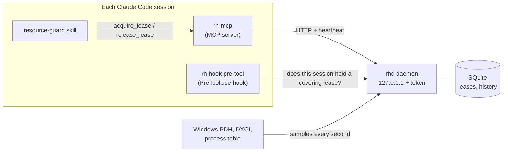

# resources-helper

[](https://github.com/meh7an/resources-helper-mcp/actions/workflows/ci.yml)
[](https://github.com/meh7an/resources-helper-mcp/releases/latest)
[](#license)


Coordinates CPU and GPU heavy work between the Claude Code sessions on one Windows PC. Sessions
ask a per-user daemon for a lease before a build, test suite, benchmark, or training run, and
wait their turn when the machine is busy, instead of all compiling at once.

## Why

Run three or four Claude Code sessions on one machine and they will, sooner or later, all start
`cargo build`, a test suite, or a training run in the same minute. Each job then takes several
times longer, RAM runs out, tool calls time out, and any timing a session measures is noise.
None of the sessions can see the others.

resources-helper gives them a shared view of the machine and a ledger of who is using what. A
session reserves the cores, RAM, GPU, and VRAM a job needs before running it; when they are not
free, it waits in a queue and is told what is ahead and roughly how long.

## How it works



| Part | What it does |
|------|--------------|
| `rhd` | The daemon: samples the machine every second, keeps the lease ledger in SQLite, and serves an HTTP API on `127.0.0.1` with a bearer token. No window; it logs to a file. |
| `rh-mcp` | The MCP server each session starts (`resources-helper`): `system_snapshot`, `can_fit`, `acquire_lease`, `release_lease`, `list_leases`. It heartbeats its leases and releases them when the session ends. |
| `rh hook pre-tool` | A PreToolUse hook for the Bash and PowerShell tools. It denies a heavy command when the session holds no covering lease, and lets it through with a warning when rhd is down. |
| `resource-guard` skill | Tells Claude when and how to lease. A CLAUDE.md rule points sessions to it. |
| `rh` | The CLI: status, leases, history, daemon control, install. |

What the daemon does with a request:

- **Admission.** A lease is granted when its profile fits in what the machine has free, keeping
  a headroom (15% by default). Otherwise it queues; smaller jobs may backfill ahead of a
  queued one only when that does not delay it, so nothing starves.
- **Learned profiles.** Every released lease records what the job really used. The next run
  of the same command in the same folder is estimated from that history, not only from what
  the session declared.
- **Benchmarks.** A `benchmark_exclusive` lease drains the machine and waits for it to stay
  quiet before it is granted, so measurements are not disturbed. The background noise during
  the run is recorded on release.
- **Liveness.** Leases are kept alive by heartbeats and tied to the session's process. A
  session that ends or crashes loses its leases within a second or two, so they never leak.
- **Fail-open.** If rhd is down, the hook lets commands run with a warning instead of
  blocking every shell call.

Windows only. Everything lives in `%USERPROFILE%\.resources-helper\`, not under `AppData`,
because the Claude desktop app is MSIX-packaged and Windows redirects its writes to `AppData`
into a folder that terminal sessions cannot see.

## Install

Needs Windows 10 or 11 and Claude Code. Building from source also needs Rust (stable, MSVC
toolchain, 1.99 or newer).

1. Get the binaries, either way:

   - **Release:** download `resources-helper-<version>-x86_64-pc-windows-msvc.zip` from the
     [latest release](https://github.com/meh7an/resources-helper-mcp/releases/latest) and
     extract it.
   - **Source:** build the release binaries from the workspace root. Inside a Claude session
     this is a `cpu_heavy` lease like any other build.

     ```powershell
     cargo build --release
     ```

2. Install them by running `rh.exe install` from the extracted folder or from the build output:

   ```powershell
   target\release\rh.exe install
   ```

   This copies `rh.exe`, `rhd.exe`, and `rh-mcp.exe` to `%USERPROFILE%\.resources-helper\bin`,
   restarts rhd on the new build when it is running, copies the `resource-guard` skill to
   `~/.claude/skills/resource-guard/`, and writes the CLAUDE.md rule to
   `%USERPROFILE%\.resources-helper\claude-md-rule.md`.

3. Do the steps it prints. Each is marked `[done]` once rh finds it in place:
   1. Register the MCP server: `claude mcp add --scope user resources-helper -- "<bin>\rh-mcp.exe"`.
   2. Add the printed PreToolUse entry to `~/.claude/settings.json`. Claude Code refuses this
      edit from inside a session, so make it yourself.
   3. Paste the section from `claude-md-rule.md` into `~/.claude/CLAUDE.md` between sessions.
   4. Run the printed PowerShell lines to register the `resources-helper` logon task. It
      starts rhd when you log on, needs no admin, and has no time limit.

4. Start a new Claude session (sessions load MCP servers only when they start), then check:

   ```powershell
   ~\.resources-helper\bin\rh.exe status
   claude mcp get resources-helper
   ```

Running `rh install` again is safe; it only overwrites its own files. To type `rh` anywhere,
add `%USERPROFILE%\.resources-helper\bin` to your user `PATH` (optional; the examples below
assume it).

## Usage

Once installed there is nothing to call by hand: the skill and the CLAUDE.md rule make each
session lease before a heavy command, and the hook stops the ones that forget. A typical
exchange inside a session:

1. Claude is about to run `cargo test --workspace`, so it calls `acquire_lease` with the class
   `cpu_heavy` and the command as label.
2. The machine is busy with another session's build, so the lease comes back `queued` with what
   is ahead and an estimated wait. Claude tells you in one line and waits.
3. The other build's lease is released; this one is granted, the tests run, and Claude calls
   `release_lease`.

The classes are `light`, `cpu_heavy`, `gpu_heavy`, and `mixed`; timing work adds the lease
kind `benchmark_exclusive`. `rh classes` prints the class profiles and the rules that decide
which commands count as heavy.

### Everyday commands

| Command | Shows or does |
|---------|---------------|
| `rh status` | Machine usage, sessions, and their leases. Starts rhd if it is down. |
| `rh leases [--all]` | Active and queued leases, or the most recent ones in any state. |
| `rh history [FINGERPRINT]` | What past jobs needed, or the runs of one job. |
| `rh classes` | The heavy-command rules and class profiles in effect. |
| `rh daemon start\|stop\|status` | Control rhd. `status` never starts it. |

## Configuration

`%USERPROFILE%\.resources-helper\config.toml` is optional. Each table overrides the defaults
field by field, unknown keys are rejected, and rhd reloads the file within 5 s. The common
keys:

```toml
[admission]
headroom_pct = 15          # capacity kept free of leases

[hook]
fail_open = true           # let commands run when rhd is down

[benchmark]
max_quiet_wait_secs = 60   # grant a benchmark without quiet after this long
```

Every key, the class profiles, and the classifier rules are in the
[runbook](docs/runbook.md#configuration).

## Upgrade

Repeat steps 1 and 2 with the new release or a fresh build. Binaries that running sessions hold
open cannot be overwritten, so `rh install` renames each old file aside
(`rh-mcp.old-<millis>.exe`) and copies the new one in. Old copies that are still in use are
listed and deleted by the next install. rhd restarts on the new build and restores its active
and queued leases. Open sessions keep their old `rh-mcp` until they restart. The hook picks up
the new `rh.exe` at once.

## Uninstall

1. Remove the PreToolUse entry from `~/.claude/settings.json` first, so sessions stop calling
   an `rh.exe` that is about to go away.
2. Run the uninstall from the extracted release or the build output, not from the bin
   directory (a running exe cannot delete itself):

   ```powershell
   target\release\rh.exe uninstall
   ```

   It stops rhd, removes the binaries, the skill copy, and the rule copy, and prints what is
   still registered: the MCP server, the hook, the CLAUDE.md section, and the logon task. The
   database, token, config, and logs stay. `rh uninstall --purge` deletes them too.

## Files

All under `%USERPROFILE%\.resources-helper\`:

| Path | Contents |
|------|----------|
| `bin\` | `rh.exe`, `rhd.exe`, `rh-mcp.exe` |
| `config.toml` | Optional overrides of the defaults. rhd reloads it within 5 s. |
| `rh.db` | Leases, their audit trail, and job history (SQLite, WAL). |
| `token` | The bearer token clients send to rhd. |
| `logs\rhd.log` | The daemon log, rotated at 10 MB, five files kept. |
| `claude-md-rule.md` | The CLAUDE.md section, written by `rh install`. |

## Troubleshooting

Health checks, fail-open behavior, crash recovery, and resetting the database are in the
[runbook](docs/runbook.md). The quickest checks:

- `rh daemon status` tells you whether rhd is up, its version, and its port.
- A heavy command "Blocked by resources-helper" in a session without an `acquire_lease` tool
  means the session started before the MCP server was registered; start a new one.
- Every heavy command running with a "runs unchecked" warning means rhd is down; read the end
  of `logs\rhd.log`.

## Platform support

Windows 10 and 11 on x86_64 only. The sampler reads Windows performance counters (PDH) and
DXGI for vendor-neutral GPU and VRAM usage, and the install registers a Windows logon task.
GPU numbers cover one adapter.

## Contributing

Issues and pull requests are welcome; see [CONTRIBUTING.md](CONTRIBUTING.md). Report security
issues privately as described in [SECURITY.md](SECURITY.md). Changes are listed in
[CHANGELOG.md](CHANGELOG.md).

## License

Licensed under either of

- Apache License, Version 2.0 ([LICENSE-APACHE](LICENSE-APACHE) or
  <https://www.apache.org/licenses/LICENSE-2.0>)
- MIT license ([LICENSE-MIT](LICENSE-MIT) or <https://opensource.org/licenses/MIT>)

at your option.

Unless you explicitly state otherwise, any contribution intentionally submitted for inclusion
in the work by you, as defined in the Apache-2.0 license, shall be dual licensed as above,
without any additional terms or conditions.
